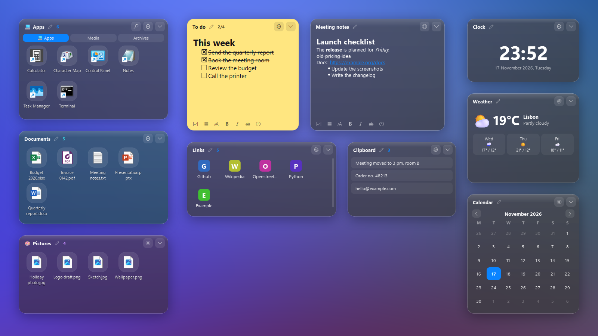
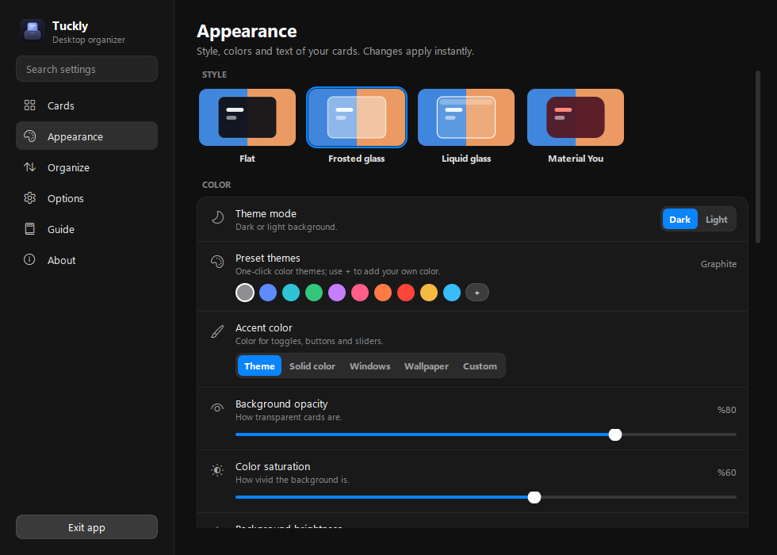
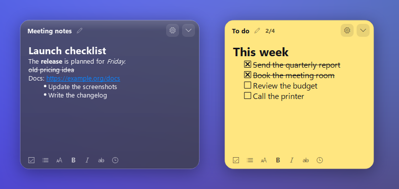
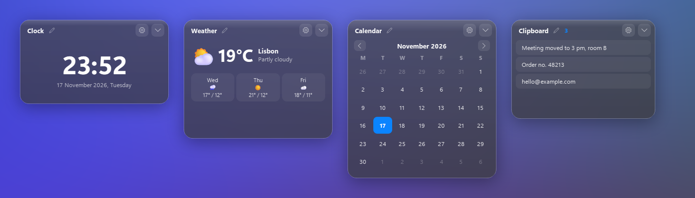
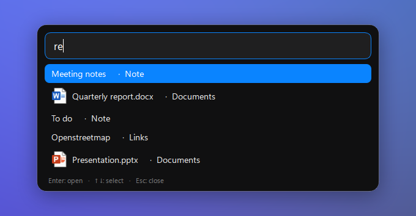
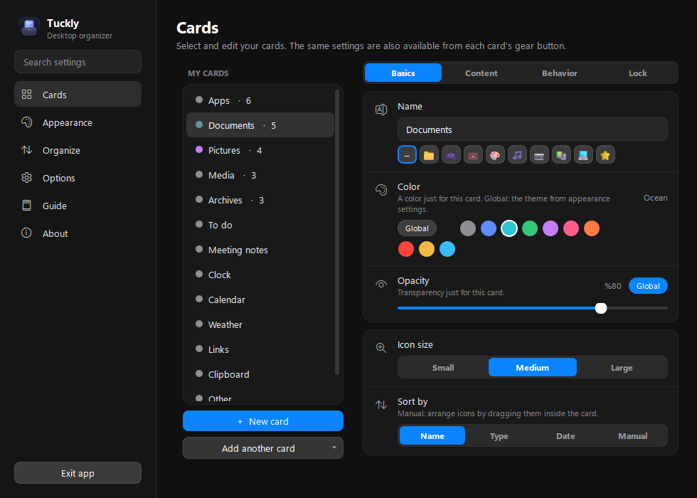
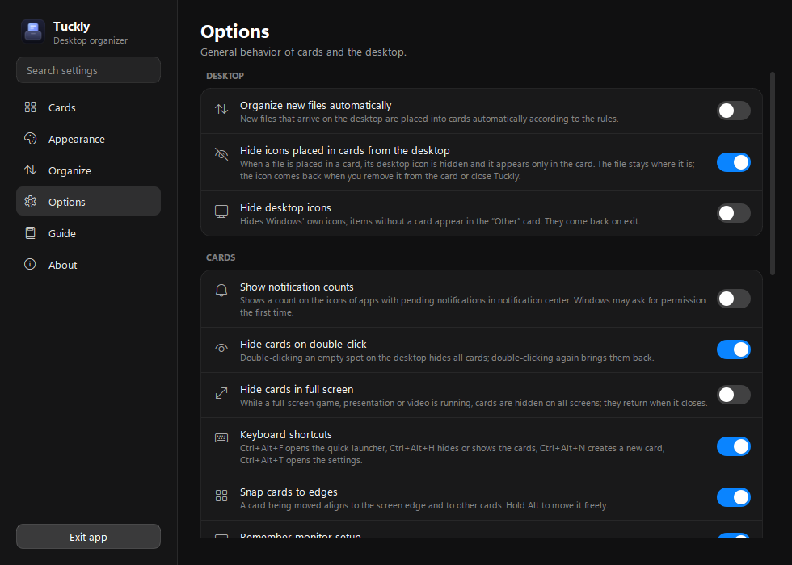

<p align="center">
  
</p>

<p align="center">
  A desktop organizer for Windows: glass cards that group your desktop icons, without moving your files.
</p>

<p align="center">
  <a href="README.tr.md">Türkçe</a>
</p>

---

Tuckly puts translucent cards on your desktop. Drag a file or shortcut onto a card and it is shown there; the
file itself never moves. While Tuckly runs, the icon is hidden from the desktop and appears only in its card.
When Tuckly quits, your desktop is exactly as it was.





## Features

### Cards

- **Cards for your desktop.** Group shortcuts, documents and folders. Files stay where they are.
- **Folder cards you can browse.** Show any folder as a card; double-click a subfolder to step into it, with
  a back button and a path bar.
- **Tabbed cards.** Combine several cards in one place and switch between them with tabs.
- **Open on hover.** A card can stay as a title only and open when the pointer is over it.
- **Schedules.** Show a card only on the days and hours you choose.
- **Recent files card.** Lists the files you opened most recently in Windows.
- **Templates.** Work, Gaming, Design and Student sets add ready-made cards in one click.

### Notes



- **Note cards** with to-do items and a done/total counter, bullets, headings, bold, italic and strikethrough.
- **Sticky-note paper colors**, text size and word wrap, set per note.
- **Links** in a note are highlighted and open with Ctrl+click.
- **Reminders.** Pick a time; a Windows notification appears and the note comes to the front.
- **Export.** Copy a note or save it as `.txt` or Markdown.

### Clock, calendar, weather and more



- **Clock and calendar cards.**
- **Weather card** for a city you enter, with a three-day forecast.
- **Clipboard card** that keeps the last 20 texts you copied; click one to copy it again.
- **Web links card** with site icons; drag an address from the browser onto it.

### Finding and arranging



- **Quick launcher.** Press Ctrl+Alt+F, type a name and press Enter. It searches every card, your notes and
  your web links.
- **Search inside a card** from the magnifier in the title of crowded cards.
- **Automatic organizing.** Pick categories per card (shortcuts, documents, images, video...) or words that
  item names must contain, and place every loose desktop item with one click. Undo is one click too.
- **Hide everything.** Double-click an empty spot on the desktop or press Ctrl+Alt+H to hide all cards; the
  same action brings them back. Cards can also hide by themselves while a full-screen app is running.
- **Snapping and multi-select.** Moving cards snap to screen edges and to each other. Ctrl+click several card
  titles to move them together, align them or give them the same size.
- **Layouts.** Save the position, size and content of all cards under a name and restore them later. Card
  positions are also remembered per monitor setup.

### Look and feel

- **Four styles.** Flat, frosted glass, liquid glass and Material, in dark or light mode, with preset and
  custom colors, opacity, saturation, brightness, corner radius and fonts.
- **Accent color** from the theme, from Windows, from your wallpaper, or your own.
- **Per-card control.** Color, opacity, icon size, title emoji, sort order (name, type, date, manual) and
  locks for position, size and content.

| Cards | Card settings |
| --- | --- |
|  |  |



### Everything else

- **Explorer integration.** "New Tuckly card" and "Add to Tuckly card" in the right-click menu.
- **Notification badges.** Optional count on app shortcuts that have notifications waiting.
- **Settings export, import and reset**, update check, installer and uninstaller.
- **Six languages.** Turkish, English, German, Spanish, French and Russian.
- **Guided tour** on first run, and a built-in guide.

## Install

Download `Tuckly-Setup-<version>.exe` from the [Releases page](https://github.com/sabriemin/tuckly/releases) and run it. The installer needs no administrator
rights and installs for the current user only.

Requirements: Windows 10 or 11 (64-bit). The glass styles look best on Windows 11.

To uninstall, use **Settings > Apps** in Windows or **About > Uninstall Tuckly** inside the app. Either way,
hidden desktop icons are restored first and your files are not touched.

## Quick guide

| To do this | Do this |
| --- | --- |
| Create a card | Control panel > Cards > **+ New card**, or right-click the desktop > **New Tuckly card** |
| Put something in a card | Drag it from the desktop onto the card |
| Take it out again | Drag it out of the card, or right-click it > **Remove from card** |
| Move or resize a card | Drag the title; drag the bottom-right corner. Double-click the title to collapse |
| Rename a card | Click the pencil next to the name |
| Change one card | Click the gear on the card |
| Change how everything looks | Control panel > **Appearance** |
| Tidy the whole desktop | Give cards categories, then Control panel > **Organize** |
| Add a note, clock, weather or other card | Control panel > Cards > **Add another card** |
| Find and open anything | Press **Ctrl+Alt+F**, type, press Enter |
| Hide or show all cards | Double-click an empty spot on the desktop, or press **Ctrl+Alt+H** |
| Combine cards into tabs | Card gear > **Behavior** > **Tabs**, then select the cards |
| Select several cards | Ctrl+click their titles; right-click a title to align or resize |
| Save the current arrangement | Control panel > Options > **Layouts** |
| Open the control panel | Click the Tuckly icon in the notification area |

The same guide is available inside the app under **Guide**, together with a tour you can replay.

### Good to know

- **Your files are never moved or deleted by placing them in a card.** A card stores only a reference. Folder
  cards are the exception: dropping a file on a folder card moves it into that folder, as Explorer would.
- **Hidden icons.** A placed item is hidden on the desktop by marking it hidden (and, if Explorer is set to
  show hidden files, also as a system file). Tuckly removes the marks when the item leaves its card and when
  Tuckly quits. If Tuckly is killed instead of quit, start it again and quit normally to restore the icons.
- **Windows 11 right-click menu.** The Tuckly entries are in the classic menu, under **Show more options**.
- **Notification badges** count notifications waiting in the notification center, not an app's own unread
  count, and are matched to shortcuts by name.

- **Network use.** Tuckly connects to the internet only for these: the update check (GitHub), a weather card
  (Open-Meteo; only the city name you typed and its coordinates are sent) and a web links card (the icon of
  each site you add is downloaded from that site). Without a weather or links card, only the update check
  runs, and it can be turned off.
- **Clipboard card.** The history is kept in memory only. It is never written to disk and is erased when
  Tuckly closes.
- **Global shortcuts** are Ctrl+Alt+F (launcher), Ctrl+Alt+H (hide or show), Ctrl+Alt+N (new card) and
  Ctrl+Alt+T (settings). A shortcut already taken by another program is skipped.

## Run from source

```
git clone https://github.com/sabriemin/tuckly.git
cd tuckly
python -m pip install -r requirements.txt
python run.py
```

Python 3.11 or newer. Settings are stored in `%APPDATA%\Tuckly\settings.json`.

| Task | Command |
| --- | --- |
| Run the smoke test | `python tests/smoke_test.py` |
| Check translations | `python tools/extract_strings.py` |
| Build `dist\Tuckly\Tuckly.exe` | `exe_olustur.bat` (PyInstaller, see `tuckly.spec`) |
| Build the installer | `kurulum_olustur.bat` (needs Inno Setup 6) |
| Regenerate icons from the SVG | `python tools/build_icons.py` |

The smoke test uses a fake desktop and its own settings folder; it does not touch your real desktop.

## Contributing

Bug reports, translations and pull requests are welcome. See [CONTRIBUTING.md](CONTRIBUTING.md).

Translations other than Turkish were not reviewed by native speakers; corrections are especially welcome.

## License

[GPL-3.0](LICENSE). The visual language of the settings window is inspired by
[Nectar](https://github.com/kua8/Nectar).
