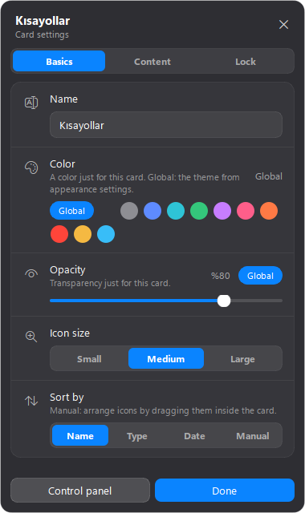

<p align="center">
  
</p>

<p align="center">
  A desktop organizer for Windows: glass cards that group your desktop icons, without moving your files.
</p>

<p align="center">
  <a href="README.tr.md">Türkçe</a>
</p>

---

Tuckly puts translucent cards on your desktop. Drag a file or shortcut onto a card and it is shown there; the
file itself never moves. While Tuckly runs, the icon is hidden from the desktop and appears only in its card.
When Tuckly quits, your desktop is exactly as it was.


## Features

- **Cards for your desktop.** Group shortcuts, documents and folders. Files stay where they are.
- **Folder cards.** Show any folder as a card.
- **Four styles.** Flat, frosted glass, liquid glass and Material, in dark or light mode, with preset and
  custom colors, accent color, opacity, saturation, brightness, corner radius and fonts.
- **Automatic organizing.** Pick categories per card (shortcuts, documents, images, video...) and place every
  loose desktop item with one click. Undo is one click too.
- **Per-card control.** Color, opacity, icon size, sort order (name, type, date, manual) and locks for
  position, size and content.
- **Explorer integration.** "New Tuckly card" and "Add to Tuckly card" in the right-click menu.
- **Notification badges.** Optional count on app shortcuts that have notifications waiting.
- **Six languages.** Turkish, English, German, Spanish, French and Russian.
- **Guided tour** on first run, and a built-in guide.

| Cards | Card settings |
| --- | --- |
|  |  |

## Install

Download `Tuckly-Setup-<version>.exe` from the [Releases page](https://github.com/sabriemin/tuckly/releases) and run it. The installer needs no administrator
rights and installs for the current user only.

Requirements: Windows 10 or 11 (64-bit). The glass styles look best on Windows 11.

To uninstall, use **Settings > Apps** in Windows or **About > Uninstall Tuckly** inside the app. Either way,
hidden desktop icons are restored first and your files are not touched.

## Quick guide

| To do this | Do this |
| --- | --- |
| Create a card | Control panel > Cards > **+ New card**, or right-click the desktop > **New Tuckly card** |
| Put something in a card | Drag it from the desktop onto the card |
| Take it out again | Drag it out of the card, or right-click it > **Remove from card** |
| Move or resize a card | Drag the title; drag the bottom-right corner. Double-click the title to collapse |
| Rename a card | Click the pencil next to the name |
| Change one card | Click the gear on the card |
| Change how everything looks | Control panel > **Appearance** |
| Tidy the whole desktop | Give cards categories, then Control panel > **Organize** |
| Open the control panel | Click the Tuckly icon in the notification area |

The same guide is available inside the app under **Guide**, together with a tour you can replay.

### Good to know

- **Your files are never moved or deleted by placing them in a card.** A card stores only a reference. Folder
  cards are the exception: dropping a file on a folder card moves it into that folder, as Explorer would.
- **Hidden icons.** A placed item is hidden on the desktop by marking it hidden (and, if Explorer is set to
  show hidden files, also as a system file). Tuckly removes the marks when the item leaves its card and when
  Tuckly quits. If Tuckly is killed instead of quit, start it again and quit normally to restore the icons.
- **Windows 11 right-click menu.** The Tuckly entries are in the classic menu, under **Show more options**.
- **Notification badges** count notifications waiting in the notification center, not an app's own unread
  count, and are matched to shortcuts by name.

## Run from source

```
git clone https://github.com/sabriemin/tuckly.git
cd tuckly
python -m pip install -r requirements.txt
python run.py
```

Python 3.11 or newer. Settings are stored in `%APPDATA%\Tuckly\settings.json`.

| Task | Command |
| --- | --- |
| Run the smoke test | `python tests/smoke_test.py` |
| Check translations | `python tools/extract_strings.py` |
| Build `dist\Tuckly\Tuckly.exe` | `exe_olustur.bat` (PyInstaller, see `tuckly.spec`) |
| Build the installer | `kurulum_olustur.bat` (needs Inno Setup 6) |
| Regenerate icons from the SVG | `python tools/build_icons.py` |

The smoke test uses a fake desktop and its own settings folder; it does not touch your real desktop.

## Contributing

Bug reports, translations and pull requests are welcome. See [CONTRIBUTING.md](CONTRIBUTING.md).

Translations other than Turkish were not reviewed by native speakers; corrections are especially welcome.

## License

[GPL-3.0](LICENSE). The visual language of the settings window is inspired by
[Nectar](https://github.com/kua8/Nectar).
