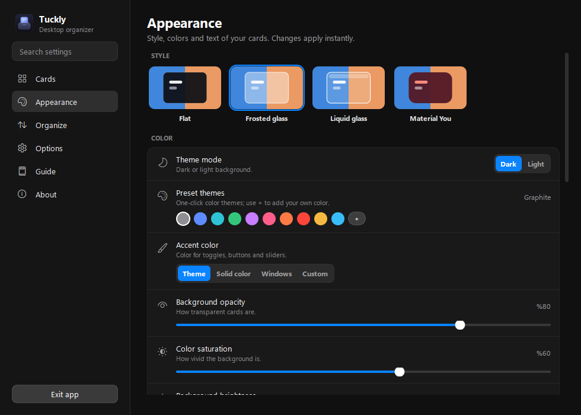
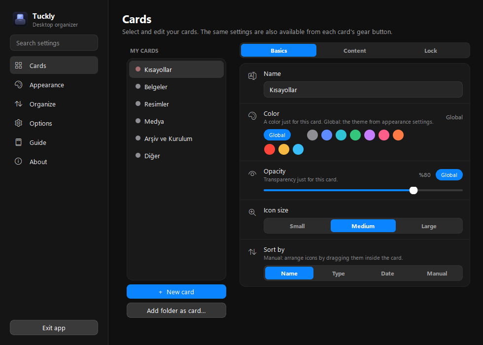

<p align="center">
  
</p>

<p align="center">
  Windows için masaüstü düzenleyici: dosyalarınızı taşımadan masaüstü simgelerini gruplayan cam kartlar.
</p>

<p align="center">
  <a href="README.md">English</a>
</p>

---

Tuckly masaüstünüze yarı saydam kartlar koyar. Bir dosyayı ya da kısayolu kartın üzerine sürüklediğinizde
öğe o kartta gösterilir; dosyanın kendisi yerinden oynamaz. Tuckly çalışırken simge masaüstünde gizlenir ve
yalnızca kartında görünür. Tuckly kapanınca masaüstünüz olduğu gibi geri gelir.



## Özellikler

- **Masaüstü kartları.** Kısayolları, belgeleri ve klasörleri gruplayın. Dosyalar yerinde kalır.
- **Klasör kartları.** İstediğiniz klasörü kart olarak gösterin.
- **Dört stil.** Düz, buzlu cam, sıvı cam ve Material; koyu ya da açık mod, hazır ve özel renkler, vurgu
  rengi, opaklık, doygunluk, parlaklık, köşe yuvarlaklığı ve yazı tipi ayarları.
- **Otomatik düzenleme.** Her karta kategori seçin (kısayollar, belgeler, resimler, videolar...) ve kartsız
  tüm masaüstü öğelerini tek tıkla yerleştirin. Geri almak da tek tık.
- **Kart başına ayar.** Renk, opaklık, simge boyutu, sıralama (ad, tür, tarih, serbest) ve konum, boyut,
  içerik kilitleri.
- **Gezgin ile bütünleşme.** Sağ tık menüsünde "Yeni Tuckly kartı" ve "Tuckly kartına ekle".
- **Bildirim rozetleri.** İsteğe bağlı olarak, bekleyen bildirimi olan uygulamaların kısayolunda sayı.
- **Altı dil.** Türkçe, İngilizce, Almanca, İspanyolca, Fransızca ve Rusça.
- **Rehber turu** ilk açılışta, ayrıca uygulama içinde bir rehber.

| Kartlar | Kart ayarları |
| --- | --- |
|  |  |

## Kurulum

Sürümler (Releases) sayfasından `Tuckly-Setup-<sürüm>.exe` dosyasını indirip çalıştırın. Kurulum yönetici
izni istemez ve yalnızca geçerli kullanıcı için kurar.

Gereksinim: Windows 10 ya da 11 (64 bit). Cam stiller en iyi Windows 11'de görünür.

Kaldırmak için Windows'ta **Ayarlar > Uygulamalar** bölümünü ya da uygulama içinde **Hakkında > Tuckly'yi
kaldır** seçeneğini kullanın. İki yolda da önce gizlenen masaüstü simgeleri geri getirilir; dosyalarınıza
dokunulmaz.

## Hızlı rehber

| Yapmak istediğiniz | Nasıl yapılır |
| --- | --- |
| Kart oluşturmak | Kontrol paneli > Kartlar > **+ Yeni kart**, ya da masaüstüne sağ tık > **Yeni Tuckly kartı** |
| Karta öğe koymak | Öğeyi masaüstünden kartın üzerine sürükleyin |
| Öğeyi çıkarmak | Kartın dışına sürükleyin ya da sağ tık > **Karttan çıkar** |
| Kartı taşımak, boyutlandırmak | Başlığından sürükleyin; sağ alt köşeden boyutlandırın. Başlığa çift tık kartı daraltır |
| Kartın adını değiştirmek | Adın yanındaki kaleme tıklayın |
| Tek bir kartı ayarlamak | Karttaki dişli düğmesine tıklayın |
| Genel görünümü değiştirmek | Kontrol paneli > **Görünüm** |
| Tüm masaüstünü düzenlemek | Kartlara kategori verin, sonra Kontrol paneli > **Düzenle** |
| Kontrol panelini açmak | Bildirim alanındaki Tuckly simgesine tıklayın |

Aynı rehber uygulamanın içinde **Rehber** sayfasında da vardır; tur oradan yeniden başlatılabilir.

### Bilmeniz gerekenler

- **Bir öğeyi karta koymak dosyayı taşımaz ve silmez.** Kart yalnızca bir başvuru tutar. Klasör kartları
  bunun istisnasıdır: bir klasör kartına bırakılan dosya, Gezgin'de olduğu gibi o klasöre taşınır.
- **Gizlenen simgeler.** Karta konan öğe, masaüstünde "gizli" (Gezgin gizli dosyaları gösterecek şekilde
  ayarlıysa ayrıca "sistem") olarak işaretlenerek gizlenir. Öğe karttan çıkınca ve Tuckly kapanınca bu
  işaretler kaldırılır. Tuckly düzgün kapatılmak yerine sonlandırılırsa, simgeleri geri getirmek için onu
  yeniden açıp normal biçimde kapatın.
- **Windows 11 sağ tık menüsü.** Tuckly girdileri klasik menüdedir: **Daha fazla seçenek göster** altında.
- **Bildirim rozetleri** uygulamanın kendi okunmamış sayısını değil, bildirim merkezinde bekleyen
  bildirimleri sayar ve kısayollarla ada göre eşleştirilir.

## Kaynak koddan çalıştırma

```
git clone <depo-adresi>
cd tuckly
python -m pip install -r requirements.txt
python run.py
```

Python 3.11 ya da daha yenisi gerekir. Ayarlar `%APPDATA%\Tuckly\settings.json` dosyasında tutulur.

| İş | Komut |
| --- | --- |
| Duman testini çalıştırmak | `python tests/smoke_test.py` |
| Çevirileri denetlemek | `python tools/extract_strings.py` |
| `dist\Tuckly\Tuckly.exe` derlemek | `exe_olustur.bat` (PyInstaller, bkz. `tuckly.spec`) |
| Kurulum dosyasını üretmek | `kurulum_olustur.bat` (Inno Setup 6 gerekir) |
| Simgeleri SVG'den yeniden üretmek | `python tools/build_icons.py` |

Duman testi sahte bir masaüstü ve kendi ayar klasörünü kullanır; gerçek masaüstünüze dokunmaz.

## Katkı

Hata bildirimleri, çeviriler ve değişiklik istekleri memnuniyetle karşılanır. Bkz.
[CONTRIBUTING.md](CONTRIBUTING.md).

Türkçe dışındaki çevirileri ana dili konuşan biri gözden geçirmedi; düzeltmeler özellikle değerlidir.

## Lisans

[GPL-3.0](LICENSE). Ayar penceresinin görsel dili [Nectar](https://github.com/kua8/Nectar) projesinden
esinlenmiştir.
