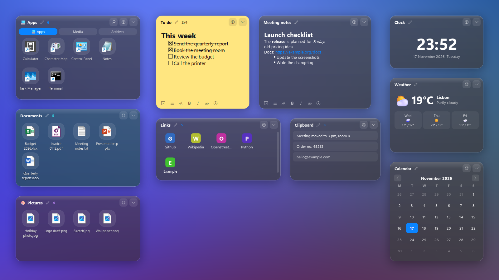
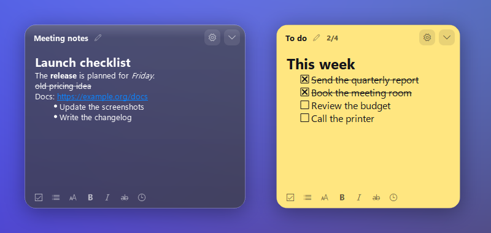
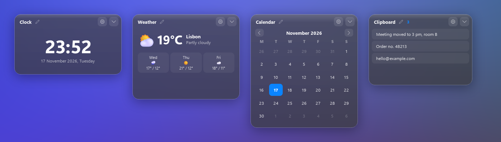
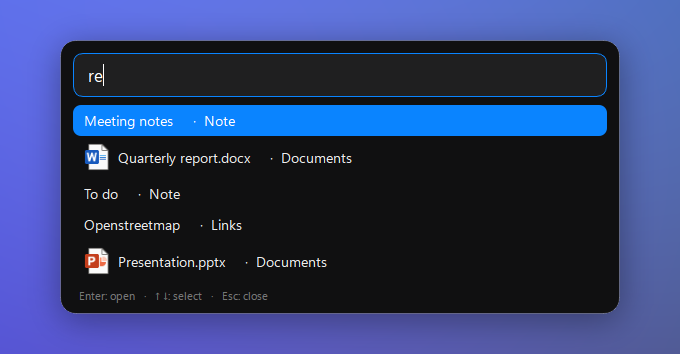
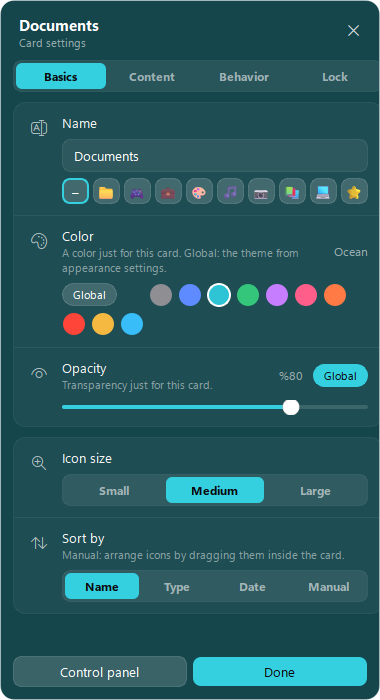
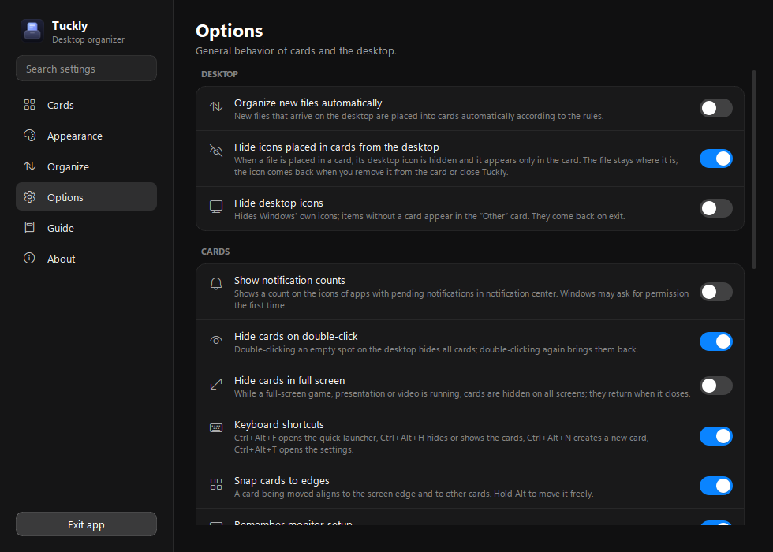

<p align="center">
  
</p>

<p align="center">
  Windows için masaüstü düzenleyici: dosyalarınızı taşımadan masaüstü simgelerini gruplayan cam kartlar.
</p>

<p align="center">
  <a href="README.md">English</a>
</p>

---

Tuckly masaüstünüze yarı saydam kartlar koyar. Bir dosyayı ya da kısayolu kartın üzerine sürüklediğinizde
öğe o kartta gösterilir; dosyanın kendisi yerinden oynamaz. Tuckly çalışırken simge masaüstünde gizlenir ve
yalnızca kartında görünür. Tuckly kapanınca masaüstünüz olduğu gibi geri gelir.




## Özellikler

### Kartlar

- **Masaüstü kartları.** Kısayolları, belgeleri ve klasörleri gruplayın. Dosyalar yerinde kalır.
- **İçinde gezilen klasör kartları.** İstediğiniz klasörü kart olarak gösterin; alt klasöre çift tıklayarak
  içine girin, geri düğmesi ve yol çubuğuyla dönün.
- **Sekmeli kartlar.** Birkaç kartı aynı yerde birleştirin, sekmelerle aralarında geçin.
- **Üzerine gelince açılma.** Kart yalnızca başlık olarak durur, fare üzerine gelince açılır.
- **Zamanlama.** Kartı yalnızca seçtiğiniz gün ve saatlerde gösterin.
- **Son kullanılanlar kartı.** Windows'ta en son açtığınız dosyaları listeler.
- **Şablonlar.** İş, Oyun, Tasarım ve Öğrenci setleri hazır kartları tek tıkla ekler.

### Notlar



- **Not kartları:** yapılacak maddeleri ve tamamlanan/toplam sayacı, madde işaretleri, başlık, kalın, italik
  ve üstü çizili yazı.
- **Yapışkan not kâğıt renkleri**, yazı boyutu ve satır kaydırma; her not için ayrı.
- **Bağlantılar** notta vurgulanır ve Ctrl+tıklama ile açılır.
- **Hatırlatıcı.** Bir zaman seçin; Windows bildirimi çıkar ve not öne gelir.
- **Dışa aktarma.** Notu kopyalayın ya da `.txt` veya Markdown olarak kaydedin.

### Saat, takvim, hava durumu ve diğerleri



- **Saat ve takvim kartları.**
- **Hava durumu kartı:** yazdığınız şehir için anlık durum ve üç günlük tahmin.
- **Pano kartı:** son kopyaladığınız 20 metni tutar; tıklayınca yeniden kopyalar.
- **Web bağlantıları kartı:** site simgeleriyle; adresi tarayıcıdan kartın üzerine sürükleyin.

### Bulma ve düzenleme



- **Hızlı başlatıcı.** Ctrl+Alt+F'ye basın, bir ad yazın, Enter'a basın. Tüm kartları, notlarınızı ve web
  bağlantılarınızı arar.
- **Kart içinde arama:** kalabalık kartların başlığındaki büyüteçle.
- **Otomatik düzenleme.** Her karta kategori (kısayollar, belgeler, resimler, videolar...) ya da öğe adında
  geçmesi gereken sözcükler seçin ve kartsız tüm masaüstü öğelerini tek tıkla yerleştirin. Geri almak da tek tık.
- **Hepsini gizleme.** Masaüstünde boş bir yere çift tıklayın ya da Ctrl+Alt+H'ye basın: tüm kartlar gizlenir,
  aynı işlemle geri gelir. Tam ekran bir uygulama çalışırken kartlar kendiliğinden de gizlenebilir.
- **Yapıştırma ve çoklu seçim.** Taşınan kart ekran kenarına ve diğer kartlara hizalanır. Birkaç kartın
  başlığına Ctrl+tıklayarak onları birlikte taşıyın, hizalayın ya da aynı boyuta getirin.
- **Düzenler.** Tüm kartların yerini, boyutunu ve içeriğini bir adla kaydedip sonra geri yükleyin. Kart
  yerleri monitör düzenine göre de hatırlanır.

### Görünüm

- **Dört stil.** Düz, buzlu cam, sıvı cam ve Material; koyu ya da açık mod, hazır ve özel renkler, opaklık,
  doygunluk, parlaklık, köşe yuvarlaklığı ve yazı tipi ayarları.
- **Vurgu rengi:** temadan, Windows'tan, duvar kâğıdınızdan ya da kendi seçtiğiniz renk.
- **Kart başına ayar.** Renk, opaklık, simge boyutu, başlık simgesi, sıralama (ad, tür, tarih, serbest) ve
  konum, boyut, içerik kilitleri.

| Kartlar | Kart ayarları |
| --- | --- |
|  |  |



### Diğer her şey

- **Gezgin ile bütünleşme.** Sağ tık menüsünde "Yeni Tuckly kartı" ve "Tuckly kartına ekle".
- **Bildirim rozetleri.** İsteğe bağlı olarak, bekleyen bildirimi olan uygulamaların kısayolunda sayı.
- **Ayarları dışa aktarma, içe aktarma ve sıfırlama**, güncelleme denetimi, kurulum ve kaldırma.
- **Altı dil.** Türkçe, İngilizce, Almanca, İspanyolca, Fransızca ve Rusça.
- **Rehber turu** ilk açılışta, ayrıca uygulama içinde bir rehber.

## Kurulum

[Sürümler sayfasından](https://github.com/sabriemin/tuckly/releases) `Tuckly-Setup-<sürüm>.exe` dosyasını indirip çalıştırın. Kurulum yönetici
izni istemez ve yalnızca geçerli kullanıcı için kurar.

Gereksinim: Windows 10 ya da 11 (64 bit). Cam stiller en iyi Windows 11'de görünür.

Kaldırmak için Windows'ta **Ayarlar > Uygulamalar** bölümünü ya da uygulama içinde **Hakkında > Tuckly'yi
kaldır** seçeneğini kullanın. İki yolda da önce gizlenen masaüstü simgeleri geri getirilir; dosyalarınıza
dokunulmaz.

## Hızlı rehber

| Yapmak istediğiniz | Nasıl yapılır |
| --- | --- |
| Kart oluşturmak | Kontrol paneli > Kartlar > **+ Yeni kart**, ya da masaüstüne sağ tık > **Yeni Tuckly kartı** |
| Karta öğe koymak | Öğeyi masaüstünden kartın üzerine sürükleyin |
| Öğeyi çıkarmak | Kartın dışına sürükleyin ya da sağ tık > **Karttan çıkar** |
| Kartı taşımak, boyutlandırmak | Başlığından sürükleyin; sağ alt köşeden boyutlandırın. Başlığa çift tık kartı daraltır |
| Kartın adını değiştirmek | Adın yanındaki kaleme tıklayın |
| Tek bir kartı ayarlamak | Karttaki dişli düğmesine tıklayın |
| Genel görünümü değiştirmek | Kontrol paneli > **Görünüm** |
| Tüm masaüstünü düzenlemek | Kartlara kategori verin, sonra Kontrol paneli > **Düzenle** |
| Not, saat, hava durumu ya da başka bir kart eklemek | Kontrol paneli > Kartlar > **Başka kart ekle** |
| Herhangi bir şeyi bulup açmak | **Ctrl+Alt+F**'ye basın, yazın, Enter'a basın |
| Tüm kartları gizlemek ya da göstermek | Masaüstünde boş bir yere çift tıklayın ya da **Ctrl+Alt+H**'ye basın |
| Kartları sekmelerde birleştirmek | Karttaki dişli > **Davranış** > **Sekmeler**, sonra kartları seçin |
| Birkaç kartı seçmek | Başlıklarına Ctrl+tıklayın; hizalamak ya da boyutlandırmak için bir başlığa sağ tıklayın |
| Geçerli düzeni kaydetmek | Kontrol paneli > Seçenekler > **Düzenler** |
| Kontrol panelini açmak | Bildirim alanındaki Tuckly simgesine tıklayın |

Aynı rehber uygulamanın içinde **Rehber** sayfasında da vardır; tur oradan yeniden başlatılabilir.

### Bilmeniz gerekenler

- **Bir öğeyi karta koymak dosyayı taşımaz ve silmez.** Kart yalnızca bir başvuru tutar. Klasör kartları
  bunun istisnasıdır: bir klasör kartına bırakılan dosya, Gezgin'de olduğu gibi o klasöre taşınır.
- **Gizlenen simgeler.** Karta konan öğe, masaüstünde "gizli" (Gezgin gizli dosyaları gösterecek şekilde
  ayarlıysa ayrıca "sistem") olarak işaretlenerek gizlenir. Öğe karttan çıkınca ve Tuckly kapanınca bu
  işaretler kaldırılır. Tuckly düzgün kapatılmak yerine sonlandırılırsa, simgeleri geri getirmek için onu
  yeniden açıp normal biçimde kapatın.
- **Windows 11 sağ tık menüsü.** Tuckly girdileri klasik menüdedir: **Daha fazla seçenek göster** altında.
- **Bildirim rozetleri** uygulamanın kendi okunmamış sayısını değil, bildirim merkezinde bekleyen
  bildirimleri sayar ve kısayollarla ada göre eşleştirilir.

- **İnternet kullanımı.** Tuckly internete yalnızca şunlar için bağlanır: güncelleme denetimi (GitHub),
  hava durumu kartı (Open-Meteo; yalnızca yazdığınız şehrin adı ve koordinatı gönderilir) ve web bağlantıları
  kartı (eklediğiniz her sitenin simgesi o siteden indirilir). Hava durumu ya da bağlantı kartınız yoksa
  yalnızca güncelleme denetimi çalışır; o da kapatılabilir.
- **Pano kartı.** Geçmiş yalnızca bellekte tutulur. Diske hiç yazılmaz ve Tuckly kapanınca silinir.
- **Genel kısayollar:** Ctrl+Alt+F (başlatıcı), Ctrl+Alt+H (gizle ya da göster), Ctrl+Alt+N (yeni kart) ve
  Ctrl+Alt+T (ayarlar). Başka bir programın kullandığı kısayol atlanır.

## Kaynak koddan çalıştırma

```
git clone https://github.com/sabriemin/tuckly.git
cd tuckly
python -m pip install -r requirements.txt
python run.py
```

Python 3.11 ya da daha yenisi gerekir. Ayarlar `%APPDATA%\Tuckly\settings.json` dosyasında tutulur.

| İş | Komut |
| --- | --- |
| Duman testini çalıştırmak | `python tests/smoke_test.py` |
| Çevirileri denetlemek | `python tools/extract_strings.py` |
| `dist\Tuckly\Tuckly.exe` derlemek | `exe_olustur.bat` (PyInstaller, bkz. `tuckly.spec`) |
| Kurulum dosyasını üretmek | `kurulum_olustur.bat` (Inno Setup 6 gerekir) |
| Simgeleri SVG'den yeniden üretmek | `python tools/build_icons.py` |

Duman testi sahte bir masaüstü ve kendi ayar klasörünü kullanır; gerçek masaüstünüze dokunmaz.

## Katkı

Hata bildirimleri, çeviriler ve değişiklik istekleri memnuniyetle karşılanır. Bkz.
[CONTRIBUTING.md](CONTRIBUTING.md).

Türkçe dışındaki çevirileri ana dili konuşan biri gözden geçirmedi; düzeltmeler özellikle değerlidir.

## Lisans

[GPL-3.0](LICENSE). Ayar penceresinin görsel dili [Nectar](https://github.com/kua8/Nectar) projesinden
esinlenmiştir.
